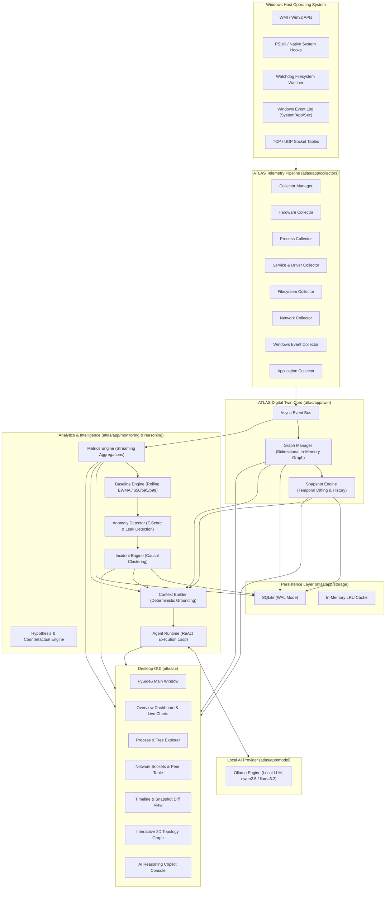

# ATLAS

> **"Understand your machine."**  
> *A local-first, AI-powered Digital Twin of a Windows computer.*

---

[-0078D6?style=flat-square&logo=windows)](https://www.microsoft.com/windows)
[](https://www.python.org/)
[](https://www.qt.io/)
[-FF6B6B?style=flat-square)](https://ollama.ai/)
[-003B57?style=flat-square&logo=sqlite)](https://www.sqlite.org/)
[](#license)

---

## Table of Contents

1. [Executive Summary](#executive-summary)
2. [What ATLAS Is (and What It Is NOT)](#what-atlas-is-and-what-it-is-not)
3. [Key Capabilities & The Questions ATLAS Answers](#key-capabilities--the-questions-atlas-answers)
4. [High-Level Architecture & Dataflow](#high-level-architecture--dataflow)
5. [Core Subsystems](#core-subsystems)
   - [1. Digital Twin & In-Memory Graph Engine](#1-digital-twin--in-memory-graph-engine)
   - [2. Continuous Telemetry & Collector Pipeline](#2-continuous-telemetry--collector-pipeline)
   - [3. Metrics, Baselines & Anomaly Detection](#3-metrics-baselines--anomaly-detection)
   - [4. Local AI Reasoning Engine & ReAct Agent](#4-local-ai-reasoning-engine--react-agent)
   - [5. Privacy, Redaction & Security Architecture](#5-privacy-redaction--security-architecture)
   - [6. High-Performance Persistence Layer](#6-high-performance-persistence-layer)
   - [7. Dark Glassmorphism Desktop UI](#7-dark-glassmorphism-desktop-ui)
6. [Repository Structure](#repository-structure)
7. [Prerequisites & System Requirements](#prerequisites--system-requirements)
8. [Installation & Setup](#installation--setup)
9. [Running ATLAS](#running-atlas)
10. [Configuration Reference (`settings.json`)](#configuration-reference-settingsjson)
11. [Monitoring Modes & Resource Budgets](#monitoring-modes--resource-budgets)
12. [Troubleshooting & Diagnostics](#troubleshooting--diagnostics)
13. [Contributing & License](#contributing--license)

---

## Executive Summary

Modern desktop operating systems execute thousands of concurrent threads, hundreds of background services, scheduled tasks, transient network sockets, and dynamic driver interactions. When performance degrades, battery life drops, or anomalous behavior occurs, standard diagnostic tools (such as Task Manager, Resource Monitor, or Event Viewer) offer only disconnected, ephemeral snapshots:
* They provide raw numbers without causal relationships.
* They lack historical context ("What changed between this morning and now?").
* They do not model how processes depend on libraries, services, registry keys, and network peers.

**ATLAS** resolves this fundamental observability gap. ATLAS constructs and continuously maintains a live, in-memory **Digital Twin** of your Windows machine. It tracks entities (CPUs, GPUs, memory banks, disks, processes, services, installed packages, files, and sockets) and the rich semantic relationships between them (`runs_as`, `connects_to`, `depends_on`, `child_of`, `accesses`, `hosts`).

Integrated directly with a local-first Large Language Model (via [Ollama](https://ollama.ai/)), ATLAS enables natural-language multi-step reasoning, hypothesis testing, and counterfactual simulation grounded in deterministic telemetry data—with **zero cloud dependencies** and **zero data leakage**.

---

## What ATLAS Is (and What It Is NOT)

| Attribute | What ATLAS Is NOT | What ATLAS IS |
| :--- | :--- | :--- |
| **Model Scope** | Not a generic web chatbot or wrapper. | A dedicated cognitive layer for Windows systems engineering. |
| **Observability** | Not just a real-time monitor or Task Manager clone. | A unified semantic graph modeling state, causality, and dependencies. |
| **Intelligence** | Not an LLM hallucinating advice from training priors. | A grounded ReAct agent querying deterministic telemetry, graph topology, and baseline deviations. |
| **Temporal Depth** | Not limited to what is happening right this second. | A time-travel engine comparing historical snapshots and configuration drift. |
| **Privacy** | Not a SaaS telemetry agent streaming computer logs to the cloud. | A 100% air-gapped, local-first engine where data stays exclusively on your machine. |

---

## Key Capabilities & The Questions ATLAS Answers

### 1. "Why is my PC slow?"
* **Root-Cause Attribution:** Correlates CPU throttling, memory paging (hard page faults), disk queue saturation, and context switching across the process hierarchy.
* **Lock & Starvation Detection:** Identifies processes hogging I/O bandwidth or starving background worker pools.

### 2. "What changed since yesterday?"
* **Temporal Snapshot Diffing:** Pinpoints software installations, driver updates, newly registered Windows services, modified autorun keys, or background startup items added within any arbitrary time window.

### 3. "What applications are thrashing my disk?"
* **I/O Attribution:** Traverses process-to-file handle links and ETW disk events to identify the exact application, process ID, and file path causing I/O spikes.

### 4. "Is this background service safe to disable?"
* **Dependency Traversal:** Inspects incoming and outgoing graph edges to identify which critical system services or user applications rely on that service before any modifications are attempted.

### 5. "What caused this crash or hang?"
* **Incident Correlation:** Links Windows Application Crash Events (Event ID 1000/1001) with anomalous baseline spikes (e.g., continuous memory growth, sudden handle exhaustion) preceding the termination.

---

## High-Level Architecture & Dataflow



---

## Core Subsystems

### 1. Digital Twin & In-Memory Graph Engine
*Located at `atlas/app/twin/`*

* **Entities (`atlas/app/twin/entities/`):**
  * `HardwareEntity`: CPU, Memory, Disk, GPU, Network Adapters, Battery.
  * `ProcessEntity`: PID, PPID, executable path, command line, user, memory working set, private bytes, threads, handles, I/O counters.
  * `ServiceEntity`: Service name, display name, status (`RUNNING`, `STOPPED`), start type (`AUTO`, `MANUAL`, `DISABLED`), binary path, dependencies.
  * `ApplicationEntity`: Installed Win32 software, UWP packages, publisher, version, install location, uninstall string.
  * `FileEntity`: Path, size, hash, extension, modified time, attributes.
  * `NetworkEntity`: Local address, remote address, port, protocol, state, owning PID.
* **Relationships (`atlas/app/twin/relationships/`):**
  * Directed, typed edges connecting entities: `runs_as`, `child_of`, `depends_on`, `connects_to`, `accesses`, `hosts`, `installed_on`.
* **Graph Manager (`atlas/app/twin/graph/graph_manager.py`):**
  * High-performance thread-safe in-memory graph.
  * Constant-time bidirectional index lookups (`get_outgoing`, `get_incoming`).
  * BFS/DFS traversal for dependency chain analysis and orphan detection.
* **Temporal Snapshots (`atlas/app/twin/snapshots/snapshot_engine.py`):**
  * Captures differential state snapshots over time.
  * Computes deep diffs between two timestamps: added entities, removed entities, and mutated properties.

### 2. Continuous Telemetry & Collector Pipeline
*Located at `atlas/app/collectors/`*

* **Hardware Collector:** Samples core loads, clock frequencies, thermal sensors (via WMI/OHM where available), memory allocations, and NVMe disk health.
* **Process Collector:** Maintains live process hierarchy trees, tracks high-frequency CPU/memory deltas, and detects short-lived transient processes.
* **Service & Driver Collector:** Monitors the Windows Service Control Manager (SCM), tracking state changes and start-type modifications.
* **Filesystem Collector:** Uses `watchdog` to monitor critical system and configuration directories (`ProgramData`, `AppData`, `System32/drivers/etc`), rate-limited to avoid I/O storms.
* **Network Collector:** Polls active TCP/UDP endpoints, resolving connections to owning PIDs and geographic/domain classifications.
* **Windows Event Collector:** Subscribes to Windows Event Channels (System, Application, Security) capturing critical warnings, crash events (Event ID 1000/1001), and service failures (Event ID 7034).
* **Application Collector:** Reconciles installed desktop software, registry uninstall keys, and Windows Store apps.

### 3. Metrics, Baselines & Anomaly Detection
*Located at `atlas/app/monitoring/`*

* **Metrics Engine:** Ingests high-frequency scalar telemetry into a ring buffer with sliding-window calculations (1-minute, 5-minute, 15-minute, 1-hour windows).
* **Baseline Engine:** Computes rolling exponentially weighted moving averages (EWMA), running standard deviations, and percentile profiles ($p_{50}$, $p_{95}$, $p_{99}$) for every critical metric per machine profile.
* **Anomaly Detector:**
  * **Z-Score Detection:** Flags sudden deviations ($|Z| \ge 3.0$) from established operational baselines.
  * **Memory Leak Trajectory:** Computes linear regressions over private bytes to identify slow, persistent leaks before OOM conditions occur.
  * **Handle / Thread Exhaustion:** Identifies unclosed kernel handles and runaway thread creation.
* **Incident Engine:** Automatically clusters related anomalies occurring within a shared temporal window into discrete, traceable Incidents with calculated severity levels (`LOW`, `MEDIUM`, `HIGH`, `CRITICAL`).

### 4. Local AI Reasoning Engine & ReAct Agent
*Located at `atlas/app/reasoning/`, `atlas/app/model/`, and `atlas/app/agent/`*

* **Deterministic Grounding (Context Builder):** Before invoking the LLM, ATLAS compiles a compact, factual JSON context package including the current hardware utilization, anomalous metric alerts, active incidents, and relevant subgraphs.
* **Hypothesis Engine:** Generates and ranks plausible hypotheses for system anomalies, matching symptoms against known failure signatures.
* **Counterfactual Engine:** Answers "What-If" queries by simulating graph mutations (e.g., "What happens to available RAM and active network connections if process `chrome.exe` (PID 14208) is terminated?").
* **ReAct Agent Runtime:** An autonomous loop with multi-step reasoning:
  1. *Thought:* Decides what diagnostic information is required.
  2. *Action:* Executes an inspection tool (e.g., `get_process_details`, `diff_snapshots`).
  3. *Observation:* Inspects deterministic results from the twin.
  4. *Synthesis:* Presents an authoritative explanation with evidence and actionable recommendations.
* **Inspection Tools:** `get_system_overview`, `get_process_details`, `get_incident_report`, `diff_snapshots`, `simulate_process_termination`, `search_graph`.

### 5. Privacy, Redaction & Security Architecture
*Located at `atlas/app/security/`*

* **Zero Cloud Telemetry:** 100% of telemetry, graph data, metrics, and LLM inference stays local on your physical machine.
* **Automated Secret & PII Redactor:** Automatically sanitizes command lines, environment variables, and file paths:
  * Redacts OAuth tokens, API keys, Bearer headers, passwords, and private tokens using regex-based entropy filters.
  * User folder names and sensitive profile paths are generalized or tokenized.
* **Permission Enforcement:** Read-only inspection tools are enabled by default. Destructive operations (process termination, service reconfiguration) require explicit user confirmation.
* **Audit Logging:** Every query, tool execution, and state inspection is recorded into an append-only SQLite audit log.

### 6. High-Performance Persistence Layer
*Located at `atlas/app/storage/`*

* **SQLite Database (`atlas.db`):** Configured with Write-Ahead Logging (`PRAGMA journal_mode = WAL`) and optimized sync (`PRAGMA synchronous = NORMAL`) to ensure high throughput without locking the UI.
* **Data Repositories:**
  * `EntityRepository`: Node state and metadata.
  * `RelationshipRepository`: Graph edge topology.
  * `MetricRepository`: Time-series telemetry with automated rolling retention pruning.
  * `SnapshotRepository`: Differential periodic snapshots.
  * `IncidentRepository`: Flagged incidents, root causes, and resolution logs.
* **In-Memory LRU Cache:** Avoids disk hits for frequently accessed entity lookups and active baseline queries.

### 7. Dark Glassmorphism Desktop UI
*Located at `atlas/ui/`*

* **Design Aesthetic:** Crafted using PySide6 (Qt6) with a bespoke, futuristic cyberpunk/glassmorphism dark theme (`#0b0e14` canvas, `#141a24` cards, neon cyan `#00d4ff` and violet `#7928ca` accents).
* **Views & Dashboards:**
  * **Overview Dashboard:** Live CPU/Memory radial gauges, GPU & Disk utilization sparklines, active incident alerts, and top resource consumers.
  * **Process View:** Hierarchical process tree with live CPU%, working set, thread counts, I/O rates, and inline search.
  * **Network View:** Live socket connection table, remote peer endpoints, port binding, and interface throughput.
  * **Application View:** Discovered applications, versions, installation timestamps, and publisher information.
  * **Timeline View:** Time-scrubber interface allowing side-by-side snapshot comparisons and change diffs.
  * **Graph Topology Visualizer:** 2D interactive canvas rendering entities and edges with force-directed physics.
  * **AI Copilot Console:** Chat console supporting streaming markdown responses, collapsible tool execution logs, and prompt shortcuts.

---

## Repository Structure

```
d:\Atlas\
│
├── requirements.txt                   # Production Python dependencies
├── README.md                          # Comprehensive system documentation
│
└── atlas/
    ├── __init__.py                    # ATLAS root package
    ├── main.py                        # Application entrypoint & Qt orchestrator
    │
    ├── app/                           # Core application backend
    │   ├── __init__.py
    │   │
    │   ├── agent/                     # Autonomous ReAct Agent subsystem
    │   │   ├── runtime/
    │   │   │   └── agent_runtime.py   # ReAct reasoning loop & tool executor
    │   │   └── tools/
    │   │       ├── inspection_tools.py# Diagnostic inspection tools
    │   │       └── tool_registry.py   # Dynamic tool registry
    │   │
    │   ├── collectors/                # Continuous OS telemetry collectors
    │   │   ├── applications/          # Win32 / UWP installed software collector
    │   │   ├── events/                # Windows Event Log (ETW) collector
    │   │   ├── filesystem/            # Watchdog file modifications collector
    │   │   ├── hardware/              # CPU, RAM, Disk, GPU, Sensor collector
    │   │   ├── network/               # Active TCP/UDP socket collector
    │   │   ├── processes/             # Process tree & resource collector
    │   │   ├── services/              # Windows Service Control Manager collector
    │   │   ├── windows/               # OS metadata & registry collector
    │   │   ├── base.py                # Base collector abstract class
    │   │   └── collector_manager.py   # Collector lifecycle coordinator
    │   │
    │   ├── core/                      # System kernel & foundations
    │   │   ├── config/
    │   │   │   └── settings.py        # Typed settings & sampling budgets
    │   │   ├── events/
    │   │   │   ├── event_bus.py       # Asynchronous pub/sub event bus
    │   │   │   └── event_types.py     # System event definitions
    │   │   ├── lifecycle/
    │   │   │   └── manager.py         # App startup, heartbeat & shutdown
    │   │   ├── logging/
    │   │   │   └── logger.py          # Structured rotating logger
    │   │   └── state/
    │   │       └── app_state.py       # Global operational state store
    │   │
    │   ├── model/                     # Local LLM integration
    │   │   ├── ollama/
    │   │   │   └── ollama_provider.py # Ollama REST streaming client
    │   │   ├── prompts/
    │   │   │   └── prompt_templates.py# System reasoning prompts
    │   │   └── providers/
    │   │       └── base_provider.py   # Abstract LLM provider interface
    │   │
    │   ├── monitoring/                # Telemetry analytics engine
    │   │   ├── anomaly/
    │   │   │   └── anomaly_detector.py# Z-score & leak detection algorithms
    │   │   ├── baselines/
    │   │   │   └── baseline_engine.py # EWMA & percentile baseline computation
    │   │   ├── incidents/
    │   │   │   └── incident_engine.py # Incident clustering & triage
    │   │   └── metrics/
    │   │       └── metrics_engine.py  # Sliding-window metric aggregation
    │   │
    │   ├── reasoning/                 # Cognitive & analytical models
    │   │   ├── context/
    │   │   │   └── context_builder.py # Deterministic context compiler
    │   │   ├── counterfactual/
    │   │   │   └── counterfactual_engine.py # "What-If" mutation simulator
    │   │   └── hypotheses/
    │   │       └── hypothesis_engine.py# Root-cause hypothesis generator
    │   │
    │   ├── security/                  # Air-gap & privacy enforcement
    │   │   ├── audit/
    │   │   │   └── audit_log.py       # Tamper-evident audit recorder
    │   │   ├── permissions/
    │   │   │   └── permission_manager.py# Role-based tool access control
    │   │   └── redaction/
    │   │       └── secret_redactor.py # PII, token, & password scrubber
    │   │
    │   ├── storage/                   # Persistence engine
    │   │   ├── cache/
    │   │   │   └── cache.py           # In-memory LRU cache
    │   │   └── sqlite/
    │   │       ├── database.py        # SQLite connection manager & WAL pragmas
    │   │       ├── repositories.py    # Typed data access repositories
    │   │       └── schema.py          # Relational tables & index schemas
    │   │
    │   └── twin/                      # Digital Twin core
    │       ├── entities/              # Domain entities (Hardware, Process, etc.)
    │       ├── graph/
    │       │   └── graph_manager.py   # In-memory graph engine & lookups
    │       ├── relationships/
    │       │   └── relationship.py    # Semantic edge definitions
    │       └── snapshots/
    │           └── snapshot_engine.py # Differential temporal snapshot engine
    │
    └── ui/                            # Presentation layer (PySide6 / Qt6)
        ├── chat/
        │   └── ai_chat_view.py        # AI Copilot interactive terminal
        ├── dashboards/
        │   ├── application_view.py    # Installed application explorer
        │   ├── network_view.py        # Network sockets & peer table
        │   ├── overview_dashboard.py  # Real-time overview dials & metrics
        │   ├── process_view.py        # Process tree explorer
        │   └── timeline_view.py       # Time-scrubbing diff analyzer
        ├── graph/
        │   └── graph_widget.py        # Interactive 2D graph visualizer
        ├── themes/
        │   └── dark_theme.py          # Dark cyberpunk glassmorphic style
        ├── widgets/
        │   ├── metric_charts.py       # Custom Qt painters: radial gauges & charts
        │   └── sidebar.py             # Navigation sidebar
        └── main_window.py             # Main Qt application window shell
```

---

## Prerequisites & System Requirements

### Hardware Requirements
* **CPU:** Modern 64-bit multi-core processor (Intel Core i5/i7/i9 10th gen+ or AMD Ryzen 5/7/9 3000+).
* **RAM:** 8 GB minimum; 16 GB or 32 GB recommended (especially when running local 7B parameter models via Ollama).
* **Storage:** 500 MB free disk space for ATLAS dependencies and SQLite database.
* **GPU (Optional but recommended):** NVIDIA RTX GPU with 6 GB+ VRAM for accelerated local LLM inference via Ollama.

### Operating System Requirements
* **Windows 10 64-bit (Version 21H2 or later)** or **Windows 11 64-bit**.
* **Administrator Privileges:** Recommended for comprehensive access to the Windows Service Control Manager, ETW security event channels, and complete process handle tables.

### Software Prerequisites
1. **Python 3.10, 3.11, or 3.12 (64-bit):**
   * Download from [python.org](https://www.python.org/downloads/).
   * Ensure **"Add Python to PATH"** is checked during installation.
2. **Ollama for Windows:**
   * Download and install from [ollama.com](https://ollama.com/download/windows).
   * Verify Ollama is running in your system tray or via PowerShell:
     ```powershell
     ollama --version
     ```

---

## Installation & Setup

### Step 1: Open PowerShell as Administrator
Right-click the Windows Start button and select **Terminal (Admin)** or **Windows PowerShell (Admin)**.

### Step 2: Navigate to ATLAS Directory
```powershell
cd d:\Atlas
```

### Step 3: Set Up a Python Virtual Environment
```powershell
python -m venv venv
.\venv\Scripts\Activate.ps1
```
*(If PowerShell displays an ExecutionPolicy error, run `Set-ExecutionPolicy -Scope Process -ExecutionPolicy Bypass` and reactivate).*

### Step 4: Install Dependencies
```powershell
pip install --upgrade pip
pip install -r requirements.txt
```

### Step 5: Pull Recommended Local AI Model
In a PowerShell window, download the default local reasoning model via Ollama:
```powershell
ollama pull qwen2.5:7b
```
*(Alternative lightweight model for lower VRAM: `ollama pull llama3.2:3b` or `ollama pull mistral:7b`).*

---

## Running ATLAS

### Standard Desktop Launch
Launch the complete application with the graphical user interface:
```powershell
python -m atlas.main
```

### What Happens on Startup:
1. **Environment Verification:** SQLite database initialized at `%LOCALAPPDATA%\ATLAS\atlas.db` with WAL mode.
2. **Collector Initialization:** Hardware, process, service, network, and event log collectors register with the event bus and begin background polling.
3. **Graph Hydration:** Initial baseline entities and relationships are populated into memory.
4. **Ollama Handshake:** ATLAS tests local HTTP connectivity to `http://localhost:11434`. If available, the AI Copilot activates immediately; if offline, ATLAS continues operating in full monitoring mode and displays an offline indicator.
5. **UI Rendering:** The PySide6 dark-theme desktop window opens, streaming live telemetry into the gauges and charts.

---

## Configuration Reference (`settings.json`)

ATLAS stores its runtime configuration at:
```
%LOCALAPPDATA%\ATLAS\config\settings.json
```

Example configuration with default values:
```json
{
  "monitoring_mode": "balanced",
  "debug": false,
  "first_run": false,
  "data_dir": "C:\\Users\\Username\\AppData\\Local\\ATLAS",
  "ollama": {
    "host": "http://localhost:11434",
    "model": "qwen2.5:7b",
    "timeout": 120,
    "max_retries": 3,
    "enabled": true
  },
  "retention": {
    "events_days": 30,
    "metrics_days": 14,
    "snapshots_days": 90,
    "incidents_days": 180,
    "audit_days": 365
  },
  "privacy": {
    "excluded_applications": [
      "KeePass",
      "1Password",
      "LastPass",
      "Bitwarden"
    ],
    "excluded_paths": [],
    "redact_command_lines": true,
    "redact_environment": true,
    "monitor_clipboard": false
  },
  "collectors": {
    "hardware_enabled": true,
    "process_enabled": true,
    "service_enabled": true,
    "application_enabled": true,
    "filesystem_enabled": true,
    "network_enabled": true,
    "event_log_enabled": true,
    "filesystem_watch_paths": [],
    "max_processes": 5000,
    "max_file_events_per_minute": 1000
  },
  "ui": {
    "theme": "dark",
    "graph_max_nodes": 500,
    "chart_history_minutes": 60,
    "refresh_rate_ms": 1000,
    "show_system_tray": true
  }
}
```

---

## Monitoring Modes & Resource Budgets

ATLAS is engineered to operate transparently in the background with minimal CPU and memory overhead. You can select between three sampling profiles depending on your workflow:

| Metric / Interval | Performance Mode | Balanced Mode *(Default)* | Quiet Mode |
| :--- | :--- | :--- | :--- |
| **Target Workload** | Active diagnosis / troubleshooting | Daily continuous twin operation | Low battery / background gaming |
| **High-Frequency Metrics** | 5 seconds | 10 seconds | 30 seconds |
| **Process Hierarchy** | 5 seconds | 10 seconds | 30 seconds |
| **Service Control Manager**| 30 seconds | 60 seconds | 120 seconds |
| **Active Network Sockets** | 5 seconds | 10 seconds | 30 seconds |
| **Filesystem Polling** | 10 seconds | 30 seconds | 60 seconds |
| **Application Inventory** | 60 seconds | 120 seconds | 300 seconds |
| **Full State Snapshots** | Every 30 minutes | Every 1 hour | Every 2 hours |
| **Target CPU Footprint** | < 1.5% CPU | < 0.5% CPU | < 0.1% CPU |

---

## Troubleshooting & Diagnostics

### 1. Ollama Connection Error
* **Symptom:** UI displays `"AI Provider: Offline"` in the status bar or chat.
* **Fix:** Verify Ollama is running locally:
  ```powershell
  curl http://localhost:11434/api/tags
  ```
  If it is not running, launch it from the Start menu or run `ollama serve` in a dedicated terminal.

### 2. PyWin32 / COM Initialization Warnings
* **Symptom:** Warnings related to `pythoncom` or WMI initialization in background threads.
* **Fix:** ATLAS handles COM threading via `pythoncom.CoInitialize()` and `CoUninitialize()` per worker thread. If running into missing DLL errors, run:
  ```powershell
  python .\venv\Scripts\pywin32_postinstall.py -install
  ```

### 3. Missing Event Log or Service Details
* **Symptom:** Security event channel or certain driver details are blank.
* **Fix:** Windows requires elevated privileges to read the Security event channel and query certain kernel service descriptors. Relaunch ATLAS by running PowerShell as **Administrator**.

### 4. Adjusting or Purging the Database
* **Location:** `%LOCALAPPDATA%\ATLAS\atlas.db`
* To completely reset ATLAS state and reinitialize the digital twin, exit the application and delete the `atlas.db` and `atlas.db-wal` files.

---

## Contributing & License

ATLAS is designed as an open, extensible systems engineering platform. Contributions in the form of additional specialized collectors (e.g., hypervisor/WSL2 tracking, DirectX GPU engine metrics, driver telemetry) and advanced reasoning tools are welcome.

* **License:** MIT License. Free for personal and commercial inspection of Windows systems.
* **Issues & Feedback:** Submit issues via the project repository issue tracker.

---

<p align="center">
  <b>ATLAS</b> — <i>Understand your machine.</i>
</p>
